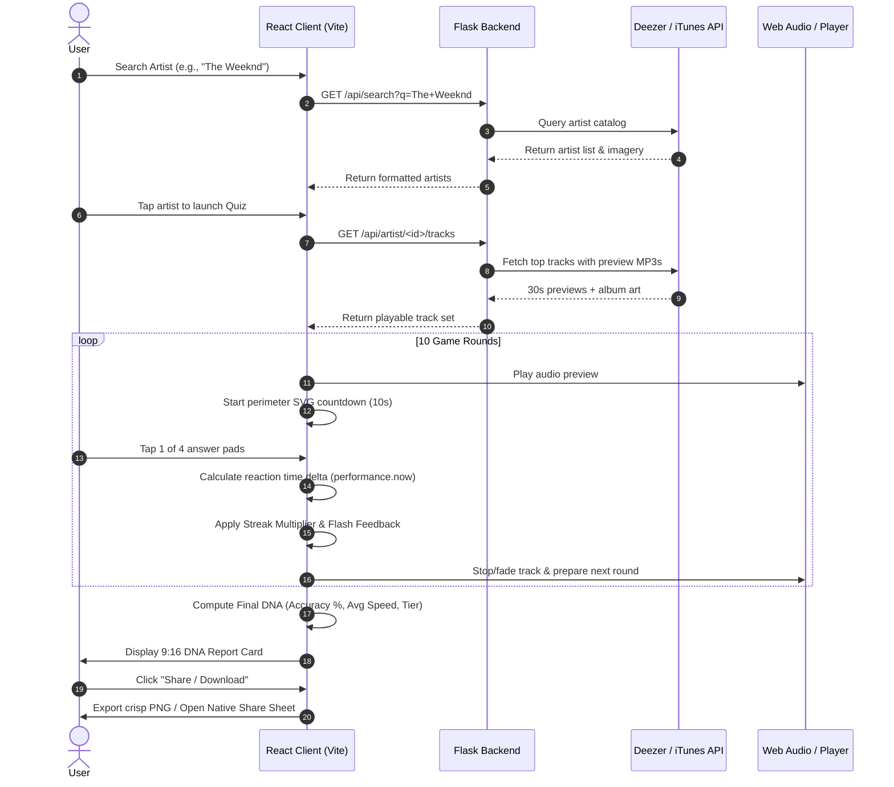
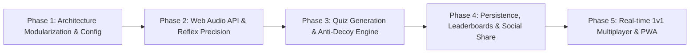

# Product Requirements Document (PRD)
## Project: SonicPulse — Music Reflex Quiz Platform
**Document Version:** 2.0.0  
**Status:** In Active Development (Phase 1 & Partial Phase 2/3 Complete)  
**Target Platform:** Mobile-First Web Application (PWA) / Cross-Platform Desktop & Mobile  
**Design Reference:** [DESIGN.md](file:///E:/All%20Other/SPOTIFY/stitch/stitch/sonic_pulse/DESIGN.md)

---

## 1. Executive Summary & Vision

### 1.1 Product Vision
**SonicPulse** transforms passive music consumption into an intense, rhythmic reflex arcade. Traditional music trivia applications are slow, turn-based, and text-heavy. SonicPulse operates like a living audio equalizer and reflex tester: users listen to high-energy 30-second audio snippets and must identify track names or artists within fractions of a second using a 4-pad reflex grid.

### 1.2 Core Value Proposition
- **High-Velocity Reflex Gameplay:** 10 rapid-fire rounds per session; sub-second reaction times trigger combo streaks ($2\times, 3\times, 5\times$) and extra point multipliers.
- **"Sonic Kineticism" Design:** Cyberpunk Obsidian Void (`#0E0E0E`) paired with Electric Neon Green (`#72FE8F`), fluid micro-interactions, perimeter SVG timers, and glassmorphic navigation docks.
- **Dual-Engine Audio Fallback:** Seamless audio preview delivery through Deezer API (primary) and Apple iTunes Search API (secondary), bypassing Spotify API preview-url restrictions.
- **Shareable "Music DNA Report":** An Instagram Story-ready 9:16 post-game recap card displaying calculated accuracy, average reflex speed in seconds, skill class (Elite, Pro, Casual, Novice), and rank percentiles.

---

## 2. Current State Analysis ("What Is Done Till Now")

Unlike earlier assessments that only examined static HTML exports, the workspace currently houses a functional full-stack prototype:

### 2.1 Full-Stack Inventory

| Component / Layer | Technology | Current Implementation Status |
| :--- | :--- | :--- |
| **Frontend Core** | React 19, Vite, Tailwind CSS 3.4 | Functional single-page application with responsive mobile frame (`450px` max-width container). |
| **Design System** | Tailwind Custom Tokens | Implemented `#0E0E0E` (surface), `#72FE8F` (primary), `#1A1A1A`–`#262626` (containers), *Plus Jakarta Sans* & *Inter* fonts. |
| **Authentication Screen** | React Component (`Login`) | Implemented login gate with credential checking against backend (`admin` / `pass123`). |
| **Search & Discovery** | React Component (`Dashboard`) | Debounced search input querying `/api/search`, live rendering artist cards with verified/cover badges. |
| **Game & Timer Engine** | React Component (`Game`, `Timer`) | 10-round game loop, perimeter SVG square countdown timer powered by `requestAnimationFrame` + `performance.now()`. |
| **Audio Playback** | React Component (`AudioPlayer`) | HTML5 audio with user-interaction unlock handler, waveform equalizer visualization, and QA auto-credit bypass on failure. |
| **DNA Report & Share** | React Component (`Report`) | 9:16 aspect ratio summary card with dynamic metric calculations and client-side PNG export via `html-to-image`. |
| **Backend API** | Flask 3.1, Python 3.12/3.13 | REST endpoints (`/api/health`, `/api/login`, `/api/search`, `/api/artist/<id>/tracks`). |
| **Music Data Services** | Deezer & iTunes Clients | Custom fallback engine: Deezer for 30s MP3 previews + album covers; iTunes as backup. |
| **Spotify Mock Service** | `SpotifyClient` & `mock_data.py` | Configurable mock mode (`MOCK_MODE=true`) or Spotify Client Credentials flow. |

---

## 3. Gap Analysis & Technical Debt

### 3.1 Frontend Shortcomings
1. **Monolithic Architecture:** `App.jsx` houses the entire application state, routing, and sub-components (`Login`, `Dashboard`, `Game`, `App`) in a single 472-line file.
2. **Hardcoded API URLs:** Requests are dispatched directly to `http://${window.location.hostname}:5000` rather than utilizing Vite environment variables (`VITE_API_URL`).
3. **Standard HTML5 Audio vs Web Audio API:** The current player uses `<audio>` tags. This introduces slight browser-level decode latency. Migration to Web Audio API (`AudioContext`) with preloaded `AudioBuffer` will guarantee instant, sample-accurate playback.
4. **Simplistic Distractor Generation:** Incorrect answers are randomly pulled from other tracks of the same artist. For artists with fewer than 4 preview tracks, the round logic can yield duplicate or empty pads.
5. **Incomplete Navigation Tabs:** The floating bottom dock displays Leaderboard and User Profile icons, but their respective views are placeholders ("Coming Soon").
6. **Social Sharing Pipeline:** Currently downloads a static PNG file. Native mobile sharing via `navigator.share()` (Web Share API Level 2) is not yet active.

### 3.2 Backend Shortcomings
1. **Stateless / Hardcoded Auth:** Single admin credentials (`admin`/`pass123`) without JWT token generation or refresh flows.
2. **No Data Persistence:** User scores, history, and leaderboards are not stored in a persistent database (PostgreSQL / SQLite / Supabase).
3. **No Request Caching:** Deezer and iTunes API queries are executed on every search keystroke without server-side caching (Redis or in-memory TTL cache).
4. **Missing Quiz Assembly Endpoint:** Quiz rounds are built on the client rather than served as pre-packaged, validated quiz challenges from the server.

---

## 4. User Personas & Workflows

### 4.1 Personas
- **The Music Superfan (Liam, 22):** Deep discography knowledge; eager to prove sub-0.5s recognition and flex verified 99th percentile stats on Instagram.
- **The Casual Commuter (Aisha, 27):** Seeks engaging 2-minute music challenges during daily travels; values instant playback without logins or lag.
- **The Competitive Arcade Gamer (Marcus, 19):** Driven by combo streaks, multiplier mechanics ($1\times \to 5\times$), and global leaderboard ranks.

### 4.2 End-to-End Game Flow

---

## 5. Game Mechanics & Mathematical Models

### 5.1 Scoring Formula

For each round $i \in [1, 10]$:
$$R_i = \max(100, 1000 - (t_i \times 100))$$
Where $t_i$ is the reaction time in seconds ($0 \le t_i \le 10$).

**Reflex Bonuses:**
- **Super Reflex ($t_i \le 1.2\text{s}$):** $R_i \leftarrow \lfloor R_i \times 1.5 \rfloor$
- **Fast Guess ($1.2\text{s} < t_i \le 3.0\text{s}$):** Standard base score
- **Incorrect Guess / Timeout:** $Score \leftarrow Score - 500$, Streak reset to $0$.

**Multiplier Multiplier:**
$$RoundScore_i = R_i \times Streak$$
Where $Streak$ increments by $+1$ for consecutive correct answers up to a maximum multiplier cap of $5\times$.

### 5.2 Performance Tier Classification

| Accuracy Threshold | Speed Threshold | Performance Class | Badge Color |
| :--- | :--- | :--- | :--- |
| $\ge 95\%$ | Avg $< 1.0\text{s}$ | **ELITE** | `#72FE8F` (Electric Neon) |
| $\ge 80\%$ | Avg $< 2.5\text{s}$ | **PRODIGY / PRO** | `#88EBFF` (Cyber Cyan) |
| $\ge 50\%$ | Any | **CASUAL** | `#ADAAAA` (Muted Grey) |
| $< 50\%$ | Any | **NOVICE** | `#FF5252` (Alert Coral) |

---

## 6. Phase-Wise Implementation Roadmap

### **Phase 1: Architecture Modularization & Environment Hygiene**
- Split monolithic `App.jsx` into structured feature modules:
  - `src/features/auth/` (`LoginModal.jsx`)
  - `src/features/dashboard/` (`Dashboard.jsx`, `ArtistCard.jsx`)
  - `src/features/quiz/` (`GameView.jsx`, `ReflexPad.jsx`, `PerimeterTimer.jsx`)
  - `src/features/report/` (`DnaReport.jsx`, `ShareControls.jsx`)
  - `src/layout/` (`FloatingNav.jsx`, `PhoneFrame.jsx`)
- Establish Axios API client with configurable base URL (`import.meta.env.VITE_API_URL`).
- Add global state management (Zustand or React Context) for user session, active quiz, and audio settings.

### **Phase 2: Web Audio Engine & Precision Reflex Clock**
- Replace HTML5 `<audio>` with a dedicated `WebAudioEngine` using `AudioContext`.
- Implement dual audio buffers: buffer $N$ plays while buffer $N+1$ pre-fetches in background, eliminating all inter-round audio load latency.
- Microsecond timing synchronization using `performance.now()`.
- Add mobile haptic feedback on answers (`navigator.vibrate([30])` on correct, `navigator.vibrate([80, 40, 80])` on miss).

### **Phase 3: Robust Quiz Engine & Server-Side Decoys**
- Introduce backend endpoint `/api/quiz/generate`:
  - Fetches target artist tracks.
  - Automatically queries related genre tracks to synthesize 3 believable distractors if the artist catalog is small.
  - Guarantees 4 unique, valid choices per round.
- Add category selection (e.g. 80s Classics, Global Top 50, Hip-Hop Legends, Indie Discoveries).

### **Phase 4: Persistence, Global Rankings & Social Virality**
- Integrate SQLite/PostgreSQL with SQLAlchemy or Supabase backend.
- Record session results: `user_id`, `artist_id`, `score`, `accuracy`, `avg_speed`, `created_at`.
- Real dynamic global leaderboard and percentile calculations.
- Web Share API Level 2: 1-tap sharing of the 9:16 DNA image card to Instagram Stories, WhatsApp, and Twitter/X.

### **Phase 5: Real-Time 1v1 Duels & Bluetooth Calibration**
- WebSocket-based 1v1 rooms (Fastest correct answer steals the round).
- Audio latency calibration wizard to compensate for Bluetooth earbud latency.
- Full Progressive Web App (PWA) manifest with service worker caching for offline replay.

---

## 7. Non-Functional Requirements (NFR)

1. **Audio Latency:** Audio playback must begin within $\le 50\text{ms}$ of round transition.
2. **Timer Accuracy:** Clock drift must not exceed $\pm 5\text{ms}$ over a 10-second countdown round.
3. **Image Export Quality:** The exported DNA report must be rendered at exactly $1080 \times 1920\text{px}$ (9:16) with pixel ratio $\ge 2$ for crisp mobile story viewing.
4. **Cross-Browser Support:** Fully operational on iOS Safari (15+), Android Chrome (100+), and desktop modern browsers.
