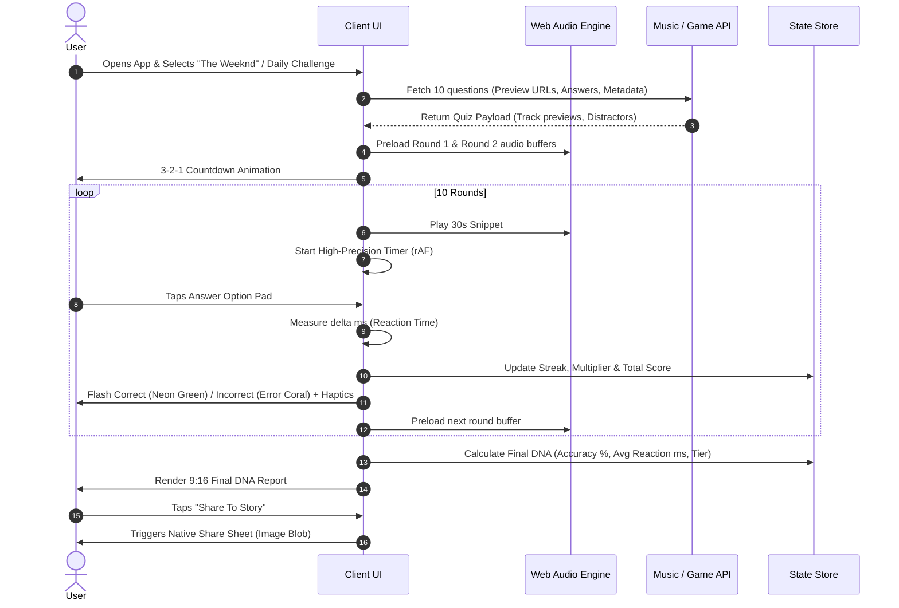

# Product Requirements Document (PRD) — Design Phase
## Project: SonicPulse — Music Reflex Quiz Platform
**Document Version:** 1.0.0 (Design Prototype Reference)  
**Master PRD (Full Stack v2.0):** [Root PRD.md](file:///E:/All%20Other/SPOTIFY/PRD.md)  
**Status:** Archived Reference / Design Specification  
**Design Reference:** [DESIGN.md](file:///E:/All%20Other/SPOTIFY/stitch/stitch/sonic_pulse/DESIGN.md)

---

## 1. Executive Summary & Vision

### 1.1 Product Vision
**SonicPulse** transforms passive music consumption into an intense, rhythmic reflex arcade. Traditional music quizzes are text-heavy and slow. SonicPulse blends music discovery with the kinetic urgency of a rhythm game. Every beat snippet tests audio recall, requiring the user to identify track names, artists, or album releases within seconds.

### 1.2 Core Value Proposition
- **High-Velocity Gameplay:** 10 rapid-fire rounds per session, sub-second responses required for top rankings.
- **"Sonic Kineticism" Aesthetic:** Cyberpunk / Neon Noir dark mode with pulsating lights, no generic 1px borders, and tactile visual feedback.
- **Social Virality & "Music DNA Report":** Automatic generation of an Instagram Story / TikTok 9:16 recap card summarizing accuracy, average reflex speed (e.g. 0.38s), performance class (Elite / Veteran / Prodigy), and global percentile.

---

## 2. Current State Analysis ("What Is Done Till Now")

The current workspace represents a high-fidelity visual design prototype exported from UI design exploration:

### 2.1 Inventory of Existing Artifacts
1. **Design System Specification ([DESIGN.md](file:///c:/Users/Jaydip/Downloads/stitch/stitch/sonic_pulse/DESIGN.md)):**
   - Detailed color tokens (Neon primary `#72FE8F`, dark surfaces `#0E0E0E` through `#262626`).
   - Core philosophy: "No-Line" rule (depth via tonal shifts), Glassmorphism navigation dock, editorial typography with *Plus Jakarta Sans* and *Inter*.
2. **Screen 1: Search & Discovery ([sonicpulse_search_adjusted_nav/code.html](file:///c:/Users/Jaydip/Downloads/stitch/stitch/sonicpulse_search_adjusted_nav/code.html)):**
   - User profile badge greeting (`Jaydeep`).
   - Artist search bar with instant query simulation.
   - Asymmetric staggered 2x2 grid displaying artist circles with hover effects.
   - "Beat Match Challenge" featured banner card with start quiz CTA.
   - Floating glass navigation bar with 4 tabs (Bolt/Play, Search, Leaderboard, Profile).
3. **Screen 2: Real-time Reflex Gameplay ([sonicpulse_gameplay/code.html](file:///c:/Users/Jaydip/Downloads/stitch/stitch/sonicpulse_gameplay/code.html)):**
   - Round tracker (`ROUND 04/10`) and dynamic progress bar.
   - Central album cover with perimeter countdown timer border.
   - Real-time multiplier and feedback banner (`⚡️ GUESSED VERY FAST! STREAK: 5X MULTIPLIER`).
   - 2x2 grid of answer buttons with active/correct state styling (`neon-glow-primary`).
4. **Screen 3: Post-Game DNA Report ([sonicpulse_final_dna_report/code.html](file:///c:/Users/Jaydip/Downloads/stitch/stitch/sonicpulse_final_dna_report/code.html)):**
   - 9:16 aspect ratio shareable graphic layout.
   - Metrics grid: Accuracy (98%), Performance Class (Elite), Avg. Reflex (0.4 SEC), Global Rank (TOP 1.2%).
   - "Share To Story" primary action button.

### 2.2 Critical Gaps & Technical Debt
- **Zero Interactivity:** All HTML files are static, non-functional mockups loaded with standalone Tailwind CDN scripts.
- **Missing Audio Architecture:** No audio loading, playing, decoding, or synchronizing system.
- **Inconsistent Color Tokens:** The DNA report uses Spotify green (`#1DB954`) while the rest of the application uses Electric Neon (`#72FE8F`).
- **Missing Navigation & Routing:** Clicking tabs, quiz cards, or options does not trigger page transitions or screen state changes.
- **Hardcoded Datasets:** No dynamic song fetching, distractor calculation, or user identity handling.

---

## 3. User Personas & Core Workflows

### 3.1 Personas
1. **The Music Snob / Superfan (Liam, 22):** Proud of his deep discography knowledge; wants to prove he recognizes songs within 0.2 seconds and share his 99th percentile score on Instagram Stories.
2. **The Casual Commuter (Aisha, 27):** Wants quick 2-minute daily musical micro-games during commutes; motivated by daily streaks and playlist variety.
3. **The Competitive Gamer (Marcus, 19):** Obsessed with speed, leaderboards, and multiplier combos; values low latency, tight timing windows, and haptic feedback.

### 3.2 End-to-End User Journey



---

## 4. System Architecture & Technical Specifications

### 4.1 Recommended Technology Stack

| Layer | Recommended Choice | Rationale |
| :--- | :--- | :--- |
| **Frontend Framework** | **React 19 / Next.js 15 (App Router)** or **Vite + React + TS** | Lightning-fast HMR, strict type safety, optimized client-side hydration for mobile web. |
| **Styling & Theme** | **Tailwind CSS v4** + Tailwind Merge | Preserves existing utility-first codebase, enables the exact token structure defined in `DESIGN.md`. |
| **State Management** | **Zustand** | Lightweight, zero-boilerplate store for game state, round timers, audio instances, and user session. |
| **Audio Playback** | **Web Audio API (`AudioContext`)** | Ultra-low latency buffer playback; precise timing down to milliseconds; supports audio frequency visualizers. |
| **Animations** | **Framer Motion** | Physics-based spring animations for button presses, 9:16 story transitions, and streak counters. |
| **Sharing / Export** | **html-to-image / Canvas API + Web Share API** | Captures the DNA Report DOM element as an ultra-crisp PNG for native social sharing. |
| **Music Catalog Provider** | **iTunes Search API / Deezer API / Spotify Web API** | Free 30-second high-quality audio previews, album artwork (600x600), and track metadata. |
| **Backend / DB** | **Supabase (PostgreSQL + Auth + Realtime)** | Instant Row Level Security for user profiles, daily challenges, and global WebSocket leaderboards. |

---

## 5. Game Mechanics & Scoring Engine

### 5.1 Timing Windows
- **Total Round Time:** 10.0 seconds per song.
- **Perimeter Ring Animation:** Linearly depletes from 100% to 0% over 10 seconds.
- **Golden Reflex Window:** $< 0.8$ seconds (Guaranteed 5x Multiplier if streak active).
- **Silver Reflex Window:** $0.8\text{s} - 2.5\text{s}$ (Standard Multiplier).
- **Bronze Window:** $2.5\text{s} - 7.0\text{s}$ (Minimal bonus).
- **Time Out:** $> 10.0$ seconds (Counted as wrong answer, resets streak).

### 5.2 Scoring Mathematical Formula

$$\text{Points}_{\text{round}} = \left( \text{Base Points} + \max\left(0, \left\lfloor \frac{T_{\text{max}} - T_{\text{reaction}}}{T_{\text{max}}} \times 1000 \right\rfloor \right) \right) \times M_{\text{streak}}$$

Where:
- $\text{Base Points} = 500$ (for correct answer)
- $T_{\text{max}} = 10,000 \text{ ms}$ (10 seconds)
- $T_{\text{reaction}} = \text{Reaction time in milliseconds}$
- $M_{\text{streak}} =$ Multiplier based on consecutive correct answers:
  - 1st correct: $1\times$
  - 2 consecutive: $2\times$
  - 3 consecutive: $3\times$
  - $4+$ consecutive: $5\times$ (Max Multiplier)
  - Wrong answer: Resets multiplier to $1\times$.

### 5.3 Performance Class Tiers

| Tier Name | Accuracy Requirement | Average Reaction Time | Percentile Bracket |
| :--- | :---: | :---: | :---: |
| **ELITE** | $\ge 90\%$ | $< 0.60\text{s}$ | Top 1.5% |
| **PRODIGY** | $\ge 80\%$ | $< 1.00\text{s}$ | Top 5.0% |
| **VETERAN** | $\ge 70\%$ | $< 1.50\text{s}$ | Top 20.0% |
| **ENTHUSIAST** | $\ge 50\%$ | $< 2.50\text{s}$ | Top 50.0% |
| **ROOKIE** | $< 50\%$ | $\ge 2.50\text{s}$ | Bottom 50.0% |

---

## 6. Functional Requirements & Feature Matrix

### 6.1 Screen 1: Home & Discovery
- **FR-101:** Dynamic Greeting displaying user name and profile picture.
- **FR-102:** Global Search input for searching any artist, track, or genre.
- **FR-103:** Debounced autocompletion querying music preview APIs.
- **FR-104:** 2x2 Asymmetric Artist Cards showcasing verified badge, follower count, and quick-launch quiz CTA.
- **FR-105:** Daily Featured Challenge card with countdown until next reset (UTC 00:00).
- **FR-106:** Persistent Glassmorphism Bottom Navigation Dock with active state indicator.

### 6.2 Screen 2: High-Speed Gameplay
- **FR-201:** Dual Audio Buffer Preloader (loads song $N$ and preloads song $N+1$ in background).
- **FR-202:** Synchronized Perimeter Countdown Timer running via `requestAnimationFrame` for stutter-free 60/120fps animation.
- **FR-203:** Dynamic 4-Option Reflex Button Grid with randomized correct placement.
- **FR-204:** Algorithmic Distractor Selection (3 incorrect songs chosen from the same artist/era to maintain difficulty).
- **FR-205:** Immediate visual state change on press:
  - Selected: Scale down to 0.95 with Neon Glow border.
  - Correct: Vibrant Green (`#72FE8F`) background + haptic buzz.
  - Incorrect: Error Coral (`#FF7351`) + double vibration + reveals correct answer.
- **FR-206:** Streak Multiplier Banner with dynamic bounce animation on consecutive hits.

### 6.3 Screen 3: Music DNA Report & Viral Sharing
- **FR-301:** Automated calculation of session metrics: Accuracy %, Performance Tier, Average Reaction Time in seconds, Global Rank percentile.
- **FR-302:** Standardized 9:16 mobile canvas optimized for Instagram Stories, Snapchat, and TikTok posts.
- **FR-303:** "Share To Story" button triggering `navigator.share()` with an auto-generated image file blob.
- **FR-304:** Direct Fallback: "Download Image" button if Web Share API is unsupported.
- **FR-305:** Replay Challenge & Explore Other Artists CTAs.

### 6.4 Additional Required Screens (Gaps to Build)
- **FR-401: Global & Friends Leaderboards:** Daily, Weekly, and All-Time high score ladders with filter by artist.
- **FR-402: User Profile & Trophy Room:** Displays accumulated badges (e.g., "Sub-0.3s Demon", "The Weeknd Superfan", "100-Streak Maestro").
- **FR-403: Audio Latency Calibration Screen:** An interactive tap calibration screen allowing players to compensate for Bluetooth earphone audio lag (0ms to 300ms delay offset).

---

## 7. Phased Implementation Roadmap

```mermaid
gantt
    title SonicPulse Implementation Roadmap
    dateFormat  YYYY-MM-DD
    section Phase 1: Architecture
    Next.js / Vite + TS Setup           :done, 2026-11-01, 3d
    Design Tokens & Glass Components     :done, 2026-11-04, 4d
    section Phase 2: Engine
    Web Audio Low-Latency Player        :active, 2026-11-08, 5d
    Reflex Timing & Scoring Engine       :active, 2026-11-13, 4d
    Gameplay Loop State Machine          :2026-11-17, 4d
    section Phase 3: Music Data
    Music API Integration (iTunes/Deezer):2026-11-21, 5d
    Distractor Generation Algorithm      :2026-11-26, 3d
    section Phase 4: Social Loop
    9:16 DNA Report Canvas Generation   :2026-11-29, 4d
    Native Web Share & Supabase Backend  :2026-12-03, 6d
    section Phase 5: Multiplayer
    1v1 Realtime WebSocket Battles       :2026-12-09, 10d
    PWA Offline Support & Calibration    :2026-12-19, 5d
```

### Phase 1: Architecture & Unified Design System (Sprint 1)
- Initialize Vite + React 19 + TypeScript + Tailwind CSS application structure.
- Reconcile color tokens:
  - Standardize on `Primary: #72FE8F` (Neon Green) across all screens.
  - Reconcile `DNA Report` styles with the core `DESIGN.md` specification.
- Extract common atomic UI components:
  - `<NavigationDock />`
  - `<PerimeterTimer />`
  - `<ReflexButton />`
  - `<GlassPanel />`
  - `<PulseProgressBar />`

### Phase 2: Core Gameplay Engine & Audio Pipeline (Sprint 2)
- Implement `AudioManager` using the Web Audio API with `AudioContext`.
- Develop high-frequency clock using `performance.now()` to measure true tap latency down to 1 millisecond.
- Build the Zustand Game Store (`useGameStore`) managing:
  - `status: 'idle' | 'countdown' | 'playing' | 'round_end' | 'game_over'`
  - `currentRound: number`
  - `score: number`
  - `streak: number`
  - `reactionTimes: number[]`
- Implement haptic feedback via `navigator.vibrate([40])` on tap.

### Phase 3: Music APIs & Dynamic Quiz Generation (Sprint 3)
- Connect to iTunes Search API (zero authentication required, global CDN, 30s high-bitrate AAC previews).
- Implement server-side proxy route `/api/music/search` to avoid CORS and rate limits.
- Implement intelligent distractor generator ensuring:
  - 4 unique options per question.
  - Options match artist name or musical genre to avoid obvious giveaways.
  - Automatic prefetching of audio buffers for consecutive rounds.

### Phase 4: Social Virality, DNA Card & Leaderboards (Sprint 4)
- Convert the 9:16 DNA Report DOM structure into a high-resolution canvas snapshot using `html-to-image`.
- Implement native mobile sharing using `navigator.share({ files: [imageFile] })`.
- Set up Supabase backend:
  - `users` table (auth, avatar, handle)
  - `sessions` table (scores, accuracy, avg_reaction_time, artist_id)
  - `leaderboards` view with daily/weekly partitions.
- Leaderboard UI screen with ranking badges and tier filters.

### Phase 5: 1v1 Real-Time Battles & Audio Calibration (Sprint 5)
- WebSocket-powered 1v1 battle rooms (players hear the same snippet simultaneously; fastest correct tap steals the round points).
- Interactive Audio Lag Calibration tool (tap to the metronome click to calibrate Bluetooth headphone delay).
- PWA manifest + service worker for offline caching of audio and app shell.

---

## 8. Data Schema & Models

### 8.1 Quiz Round Model (`QuizRound`)
```typescript
export interface QuizOption {
  id: string;
  trackName: string;
  artistName: string;
  isCorrect: boolean;
}

export interface QuizRound {
  roundNumber: number;        // e.g. 1 to 10
  trackId: string;
  trackName: string;
  artistName: string;
  albumArtUrl: string;       // 600x600 high-res image
  previewAudioUrl: string;    // 30s preview stream URL
  options: QuizOption[];      // Array of 4 options (1 correct, 3 distractors)
}
```

### 8.2 Session Performance Model (`SessionResult`)
```typescript
export interface RoundFeedback {
  roundNumber: number;
  isCorrect: boolean;
  reactionTimeMs: number;
  pointsEarned: number;
  multiplier: number;
}

export interface SessionResult {
  sessionId: string;
  artistId: string;
  artistName: string;
  artistImageUrl: string;
  totalScore: number;
  accuracyPercentage: number;   // e.g. 98.0
  averageReflexSec: number;     // e.g. 0.42
  performanceClass: 'ELITE' | 'PRODIGY' | 'VETERAN' | 'ENTHUSIAST' | 'ROOKIE';
  globalPercentile: number;     // e.g. 1.2 (Top 1.2%)
  roundBreakdown: RoundFeedback[];
  timestamp: string;
}
```

---

## 9. Non-Functional Requirements (NFR)

1. **Audio Latency:** Audio playback must begin within $< 80\text{ ms}$ of round start. Buffer preloading is required.
2. **Animation Frame Rate:** Transitions, timer clips, and hover effects must consistently achieve $60\text{ fps}$ on mid-tier mobile hardware.
3. **Responsive Scaling:** UI must flawlessly scale across standard mobile viewports ($360\text{px}$ to $430\text{px}$ width) and maintain desktop centered simulation frames.
4. **Offline Resilience:** App shell and design tokens must load instantly from Service Worker caches.

---

## 10. Summary & Sign-off

SonicPulse possesses a world-class visual identity and a clear product hook. With this PRD, the project is fully primed to advance from static HTML design prototypes to an engineering build.
